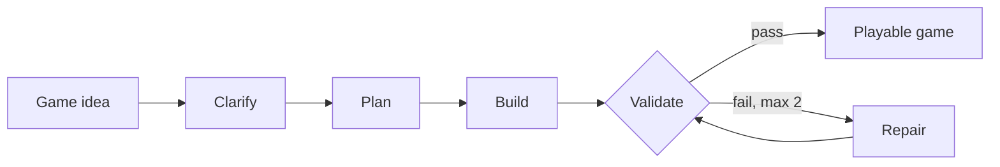

<h1 align="center">Sameer Atram</h1>

  <b>Applied AI Engineer</b> · Agentic AI, agent reliability and evaluation, RAG and agent memory

  MTech CSE, IIT Hyderabad · Agentic AI Developer at <b>Amgo Games</b> · Hyderabad, India

  
  
  

---

## About me

I build **production-oriented LLM systems**: multi-agent workflows with LangGraph, hybrid retrieval, structured outputs, guardrails and evaluation. At Amgo Games, I'm building an agentic platform that turns natural-language game ideas into playable Three.js applications.

What I care about most is proving that agents work. My projects test agents against execution results, baselines and regression gates rather than relying on demos alone, and they document what didn't work.

## Try these first

| Project | What it shows | Demo | Code |
|---|---|---|---|
| **Memory Agent** | Memory that knows which facts are current and which to distrust | [Try in browser](https://sampro14.github.io/enterprise_engineering_memory_agent/) | [Repo](https://github.com/sampro14/enterprise_engineering_memory_agent) |
| **Procedure Agent** | A regulated chat agent with an eval gate that blocks bad releases | [Try in browser](https://sampro14.github.io/procedure-agent/) | [Repo](https://github.com/sampro14/procedure-agent) |
| **AgentEval** | Finding where an agent run failed, why, and whether it recovered | [Watch below](#agenteval-multi-agent-reliability-and-evaluation-platform) | [Repo](https://github.com/sampro14/agentval_system) |
| **Agentic Game Builder** | Plain-English idea to a playable browser game | [Watch video](https://drive.google.com/file/d/1CUDBPYp_mgWnRbgeW4WAUWuMQs6DjtGV/view?usp=drive_link) | [Repo](https://github.com/sampro14/agentic-game-builder) |

---

## Featured projects

### AgentEval: Multi-Agent Reliability and Evaluation Platform

Most agent benchmarks report one success rate. AgentEval shows **where** a run went wrong, **why**, and whether it recovered.

- **Seven specialized agents** (planner, researcher, coder, executor, validator, failure analyzer, repairer) with a bounded repair loop
- **Ground truth from execution:** code runs in a locked-down Docker sandbox with CPU, memory and time limits and no network
- **Failure attribution:** a rule-based classifier with LLM fallback tags each failure with a category, the responsible agent and a fix
- **Full observability:** every step is stored with its output, latency and tokens, and can be inspected in a live dashboard

**Stack:** Python, LangGraph, FastAPI, Next.js, PostgreSQL, Redis, SQLAlchemy, Alembic, Docker, Anthropic, OpenAI, Gemini, DeepSeek, GitHub Actions

---

### Enterprise Engineering Memory Agent: Memory That Knows What's True Now

A persistent memory layer for AI agents that tracks **what is true now, what was true before, and what to distrust**.

| Synthetic benchmark, held-out seeds | Vector RAG | All docs in context | **This system** |
|---|---|---|---|
| Overall accuracy | 82% | 93% | **95%** |
| Current-fact questions | 58% | 100% | **100%** |
| Stale or poisoned answers (lower is better) | 43% | 16% | **14%** |

- **Questions across time:** what is true now, what was true on a given date, and when it changed
- **Authority-aware:** weak claims can't overwrite accepted facts; they go to a human review queue
- **Built as a service:** REST API, tenant-scoped API keys, and an async ingest queue with retries, on Postgres or SQLite
- **Honest evaluation:** it clearly beats vector RAG, but the gap over all-docs-in-context is within noise at this scale, and experience memory lost to plain history. The [report](https://github.com/sampro14/enterprise_engineering_memory_agent/blob/workbench/docs/POC_REPORT.md) covers both

**Stack:** Python, LangGraph, FastAPI, PostgreSQL, pgvector, SQLite, Docker, Gemini, Anthropic, OpenAI, GitHub Actions

---

### Procedure Agent: A Chat Agent That Follows a Written Procedure

A pattern for regulated conversations, shown on a fictional debt-collection call: the procedure is data, legal wording is verbatim, limits are enforced in code, and a change can't ship until the evals pass.

- **Verbatim disclosures:** legal wording is copied from the procedure, never generated or reworded
- **Hard limits:** offers can only come from a `PaymentPlan` that refuses out-of-bounds terms
- **A gate that is itself tested:** 9 replayed calls, 3 deterministic metrics, and 8 deliberate regressions the gate must catch
- **No server:** the live demo runs the real Python package in the browser with Pyodide

**Stack:** Python, DeepEval, pytest, Pyodide, YAML, GitHub Actions

---

### Agentic Game Builder: From an Idea to a Playable Game

Describe a game in plain English, and a team of agents clarifies, plans, builds, validates and repairs it into a playable browser game.

- **LangGraph state graph** with conditional routing for the clarification and repair loops
- **Validator** runs a 10-point static check plus an optional LLM semantic check; the repair agent fixes only the broken parts
- **Live streaming UI:** FastAPI streams each phase over Server-Sent Events; CLI and Docker modes are included

**Stack:** Python, LangGraph, OpenAI, FastAPI, Server-Sent Events, Docker

---

## Other projects

| Project | What it does | Tech stack |
|---|---|---|
| [Text-to-Animated-video](https://github.com/sampro14/Text-to-Animated-video) | Text-to-image latent diffusion pipeline: custom VAE with a GAN discriminator, CLIP-style text encoder, and a job API that streams generated images | PyTorch, Diffusers, Transformers, Accelerate, Flask |
| [Fashion-recommender](https://github.com/sampro14/Fashion-recommender) | Recommends visually similar clothes using ResNet50 image embeddings and nearest-neighbour search | TensorFlow, Keras, scikit-learn, OpenCV, Streamlit |
| [Celebrity-lookalike](https://github.com/sampro14/Celebrity-lookalike) | Detects a face in a photo and finds the closest celebrity match by embedding similarity | VGGFace, MTCNN, Keras, OpenCV, scikit-learn, Streamlit |
| [Chatbot-for-currency-conversion](https://github.com/sampro14/Chatbot-for-currency-conversion) | Intent-classification chatbot trained on a custom intents file | TensorFlow, Keras, scikit-learn, Flask |
| [Exploratory-Data-Analysis](https://github.com/sampro14/Exploratory-Data-Analysis) | Visualization, correlation and outlier handling on the Iris dataset | pandas, NumPy, Matplotlib, seaborn, Jupyter |

---

## Tech stack

| Area | Tools |
|---|---|
| **Languages** | Python, C++, JavaScript, SQL |
| **Agents and LLMs** | LangGraph, LangChain, OpenAI, Anthropic, Gemini, DeepSeek |
| **Retrieval and memory** | pgvector, Qdrant, Pinecone, FAISS, hybrid BM25 + dense retrieval, RRF |
| **Evaluation and LLM Ops** | DeepEval, LangSmith, MLflow, OpenTelemetry, pytest, Playwright |
| **Machine learning** | PyTorch, TensorFlow, Keras, scikit-learn, Diffusers, Transformers, OpenCV |
| **Backend and data** | FastAPI, Flask, PostgreSQL, Redis, SQLite, SQLAlchemy, Alembic |
| **Frontend** | Next.js, Three.js, Streamlit |
| **Infrastructure** | Docker, Docker Compose, GitHub Actions, GitHub Pages, Linux |

---

  Open to Applied AI and GenAI Engineer roles, remote or relocation. <a href="mailto:sam14atram@gmail.com">Get in touch</a>.

